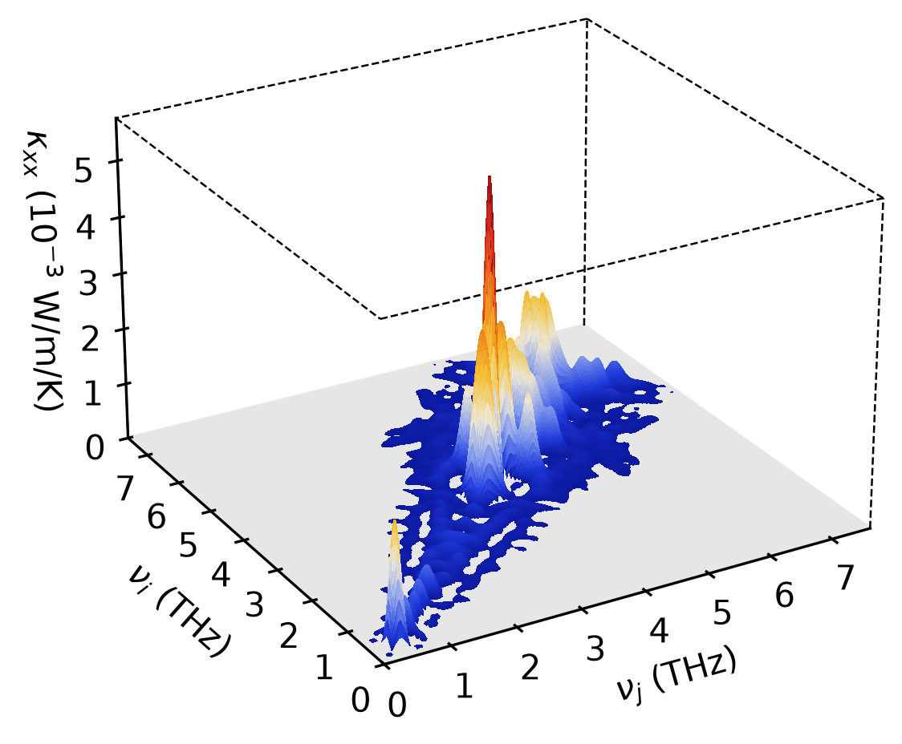

# Examples
Both examples are rocksalt NaCl with harmonic force constants from a 4x4x4 supercell.
Run them from any directory once `unifiedkappa` is installed:
```bash
python examples/shengbte_example/run.py
python examples/phonopy_example/run.py
python examples/plotting/plot.py   # needs matplotlib: pip install "unifiedkappa[plot]"
```

## `shengbte_example/`
A complete ShengBTE/FourPhonon run (3- and 4-phonon scattering, 25x25x25 mesh,
T = 300 K). `run.py` uses `UnifiedkappaManager.from_control`, which takes the supercell
and q-point mesh from `CONTROL`, and writes:
- `T300K/unifiedkappa.dat`: unified kappa from ShengBTE's RTA scattering rates. Diagonal
  group velocities come from `BTE.v_full`, so they are consistent with ShengBTE's
  scattering rates; off-diagonal velocities come from phonopy
- `minikappa-300-2.0.dat`: minimum kappa from maximum scattering rates (harmonic
  properties only)
- `T300K/unifiedkappa-{d,od}_{xx,yy,zz}.txt` and `minikappa-300-2.0-{d,od}_{xx,yy,zz}.txt`:
  the diagonal and off-diagonal contributions binned by the frequencies of the two modes
  (`save_histogram=True`)

Reading scattering rates requires `onlyharmonic=.FALSE.` in `CONTROL`. Takes ~15 s.

## `phonopy_example/`
Harmonic inputs only (`POSCAR-prim`, `FORCE_CONSTANTS`). `run.py` uses
`UnifiedkappaManager.from_parameters` on a 12x12x12 mesh and writes
`minikappa-{300,600,900}-2.0.dat`. Takes ~1 s.

## `plotting/`
`plot.py` reads the xx histograms written by `shengbte_example/run.py` (no recalculation)
and saves 3D plots of the diagonal and off-diagonal contributions to kappa_xx over the
frequencies of the two modes, as PDF and PNG (300 dpi), using `unifiedkappa.plotting`.
The off-diagonal part is drawn as a smooth surface colored by height
(`make_kappa_surface_plot`), in the style of
[Xia *et al.*, Phys. Rev. X **10**, 041029 (2020), Fig. 6(d,e)](https://doi.org/10.1103/PhysRevX.10.041029);
the diagonal part, which lies only on the nu_i = nu_j bins, is drawn as bars
(`make_kappa_histogram_plot`). For example, the off-diagonal (coherence) part of the
unified kappa at 300 K:

<p align="center">
  
</p>

| | Diagonal (particle-like) | Off-diagonal (wave-like) |
|---|---|---|
| Unified kappa, 300 K | [PDF](plotting/unifiedkappa-300K-d_xx.pdf), [PNG](plotting/unifiedkappa-300K-d_xx.png) | [PDF](plotting/unifiedkappa-300K-od_xx.pdf), [PNG](plotting/unifiedkappa-300K-od_xx.png) |
| Minikappa, 300 K | [PDF](plotting/minikappa-300K-d_xx.pdf), [PNG](plotting/minikappa-300K-d_xx.png) | [PDF](plotting/minikappa-300K-od_xx.pdf), [PNG](plotting/minikappa-300K-od_xx.png) |

The diagonal part lies on the nu_i = nu_j line. The off-diagonal part spreads to pairs of
modes with different frequencies, with a Lorentzian weight that falls off once their
frequency difference exceeds their combined linewidth; it is broader for minikappa, whose
linewidths are larger. The surface is interpolated (cubic, 8x) from the bin centers, and
regions below 0.2% of the maximum are left empty. The figures are saved without a
creation date, so rerunning `plot.py` leaves them unchanged unless the plots change. The
histograms are not symmetrized, unlike the tensors in the `.dat` files, so for cubic NaCl
the `.dat` kappa_xx is the mean of the xx, yy, and zz histogram sums.

## Output format
Each `.dat` file has three rows, each a flattened 3x3 tensor in W/m/K: the diagonal
(Peierls) part, the off-diagonal (coherence) part, and the total. Read them with
`unifiedkappa.read_minikappa_file`.

Each histogram `.txt` file is an `n_histogram_bins` x `n_histogram_bins` array in W/m/K
whose header gives the bin width `delta_freq` (rad/ps): row i and column j are the
frequency bins of the two modes, bin n spanning [n, n+1) x `delta_freq`. Read them with
`unifiedkappa.plotting.read_kappa_histogram`.

## Reference outputs
The `.dat` and histogram `.txt` files committed here are the reference outputs for the
regression tests in `tests/test_regression.py`; the figures in `plotting/` are made
from them. `run.py` overwrites them in place. Off-diagonal tensor
elements are numerical noise (~1e-17) that rounds to `0.00000000` or `-0.00000000`
depending on the run, so `git diff examples/` can show sign-of-zero changes even when the
results are identical; `pytest` compares them numerically.
